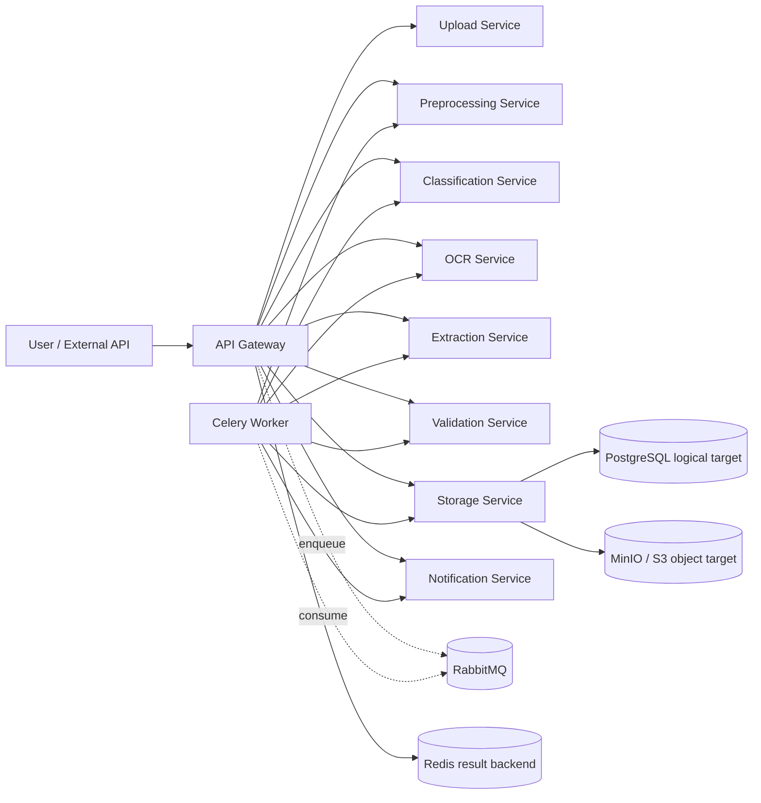

# Architecture

## High-level context

SmartDoc Processor automates ingestion and understanding of documents from scans, PDFs, forms, receipts, and handwritten notes.

## Service map

- `api-gateway`: single entry point, orchestration, auth, dashboard aggregation.
- `upload-service`: single upload, batch upload, scanner intake, temp storage.
- `preprocessing-service`: orientation, quality improvement, denoising metadata.
- `classification-service`: document type classification and authenticity hints.
- `ocr-service`: OCR/ICR text extraction with table parsing.
- `extraction-service`: NER-like entity extraction and key fields.
- `validation-service`: template validation and confidence scoring.
- `storage-service`: result storage, encrypted payloads, versions, audit, exports, learning samples.
- `notification-service`: user notifications and webhook delivery.

## Diagram

## Data flow

1. Upload request creates `doc_id` and stores temporary source.
2. Gateway creates pipeline job in storage service.
3. Worker executes stage chain and updates status after every stage.
4. Artifacts of each stage are saved for replay/restart.
5. Final validated data is encrypted and versioned.
6. Notifications and webhooks are emitted.

## Scalability model

- Horizontal scaling of every service container.
- Independent scaling of `api-worker` for throughput.
- RabbitMQ queues smooth burst uploads.
- Redis provides fast async task result backend.
- Stateless service design enables load balancing.

## Security model

- RBAC with role-bound actions.
- Signed auth tokens.
- Encrypted document result blob in storage.
- Full audit trail for upload/process/review/export.
- Temporary file cleanup endpoint for retention control.
